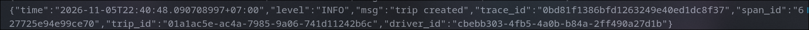
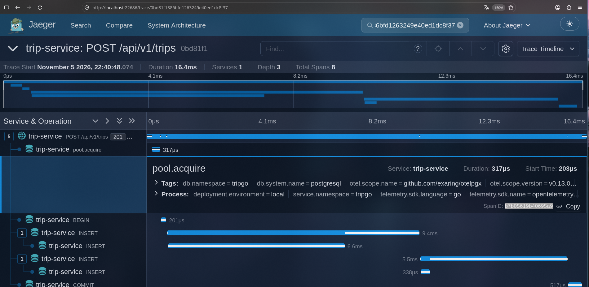
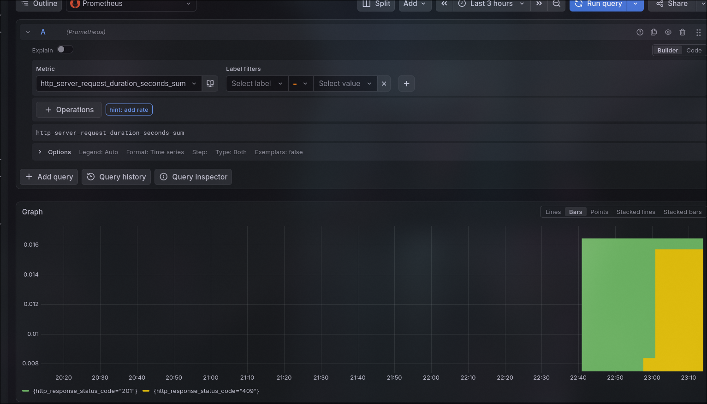

#  Запуск сервиса

##  Необходимые утилиты

*   **`make`** — утилита для сборки и автоматизации задач.
*   **`tripgoctl`** — CLI-инструмент для управления инфраструктурой.
*   **`go 1.27.2`** — компилятор и среда выполнения языка Go.

---

## Порядок действий

### Шаг 1. Подготовка инфраструктуры

Запустите локальный кластер

```bash
tripgoctl cluster start
tripgoctl environment start
tripgoctl connect
```

### Шаг 2. Запуск сервиса
Для полной сборки и старта проекта выполните команду:

```bash
make
```

>  **Что происходит автоматически при вызове `make`:**
> 1. Применяются свежие миграции базы данных.
> 2. Обновляется или создается с нуля спецификация OpenAPI.
> 3. Запускается сам сервис.
---

##  Дополнительные команды `Makefile`

Если вам нужно выполнить отдельные этапы разработки независимо друг от друга, используйте следующие команды:

*   `make generate`
    Генерация контракта и спецификации в директорию `contracts/openapi`. 
    *Примечание: если спецификация уже существует, она будет перезаписана.*
*   `make migrate`
    Выполнение и применение актуальных миграций для базы данных.
*   `make run`
    Локальный запуск сервиса (без предварительной генерации и миграций).

## Проверка телеметрии

Взял trace_id из лога
Это ендпоинт на создание поездки



Пошел в jaeger и по trace_id нашел его и спан - например pool.Aquire


Взял трейс из лога
айди трейса - 0bd81f1386bfd1263249e40ed1dc8f37 - тот же
айди спана - b7b05619b40695a9


Пошел в графану


http_server_request_duration нету -  по умолчанию otelhttp экспортит
разные виды http_server_request_duration_sum,bucket
из них можно выводит время
